The **[Framework for Benchmarking Clustering Algorithms](https://clustering-benchmarks.gagolewski.com)
is authored/edited/maintained by [Marek Gagolewski](https://www.gagolewski.com)**

[Benchmark suite](https://github.com/gagolews/clustering-data-v1) version 1.2.0

--------------------------------------------------------------------------------

**Datasets**

* [cdc/DS1](#DS1)
* [cdc/DS4](#DS4)
* [cdc/DS6](#DS6)
* [cdc/DS7](#DS7)
* [cdc/DS8](#DS8)
* [cdc/DS10](#DS10)
* [cdc/DS11](#DS11)
* [cdc/DS12](#DS12)
* [cdc/DS13](#DS13)
* [cdc/DS15](#DS15)
* [cdc/DS16](#DS16)
* [cdc/DS17](#DS17)

--------------------------------------------------------------------------------

## cdc/DS1 (n=999, d=2) 

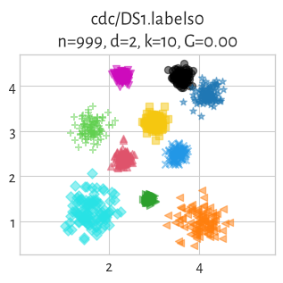

## cdc/DS4 (n=442, d=2) 

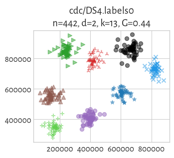

## cdc/DS6 (n=1000, d=2) 

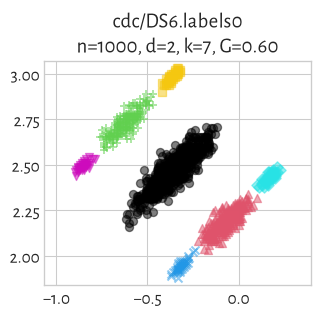

## cdc/DS7 (n=1487, d=2) 

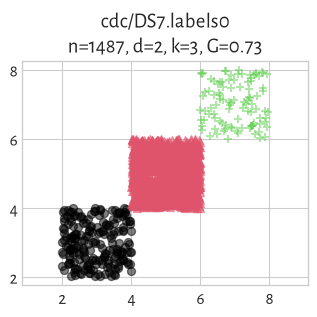

## cdc/DS8 (n=3000, d=2) 

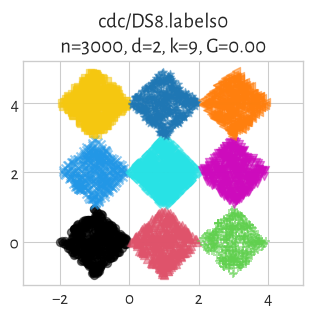

## cdc/DS10 (n=619, d=2) 

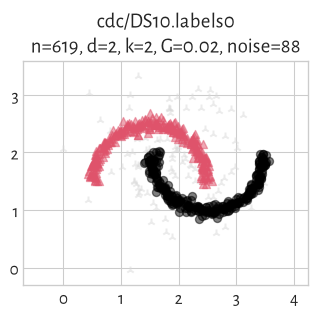

## cdc/DS11 (n=2930, d=2) 

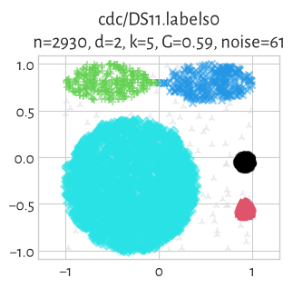

## cdc/DS12 (n=1030, d=2) 

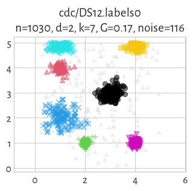

## cdc/DS13 (n=998, d=2) 

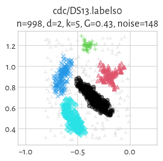

## cdc/DS15 (n=3603, d=2) 

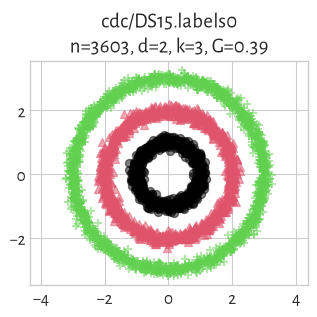

## cdc/DS16 (n=356, d=2) 

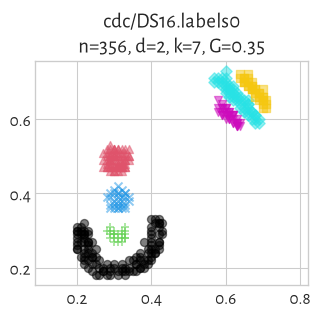

## cdc/DS17 (n=611, d=2) 

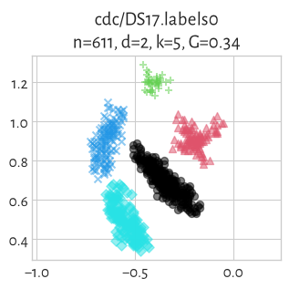

